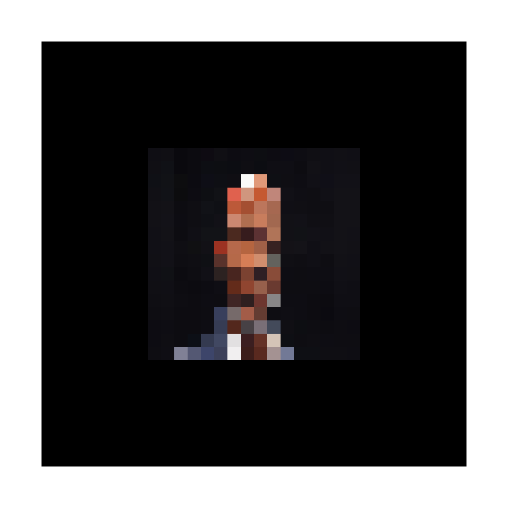

# Realidad aumentada con marcador

Un modelo 3D animado aparece sobre la imagen marcador al escanearla con la cámara del celular. Hecho con [A-Frame](https://aframe.io) y [AR.js](https://ar-js-org.github.io/AR.js-Docs/).

**Probar:** abre https://pclarow.github.io/realidad-aumentada/ en el celular, acepta el permiso de cámara y apunta a la imagen marcador.

- `index.html`: escena de realidad aumentada
- `asset.glb`: modelo 3D animado
- `marker.patt`: patrón del marcador que reconoce la cámara

Taller de Interfaces · Universidad Adolfo Ibáñez · 2026 · Pedro Claro

## Marcador

Abre o imprime esta imagen y apunta la cámara del celular hacia ella:

Link directo: https://pclarow.github.io/realidad-aumentada/marker.png
